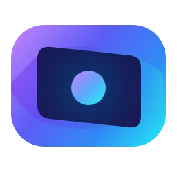
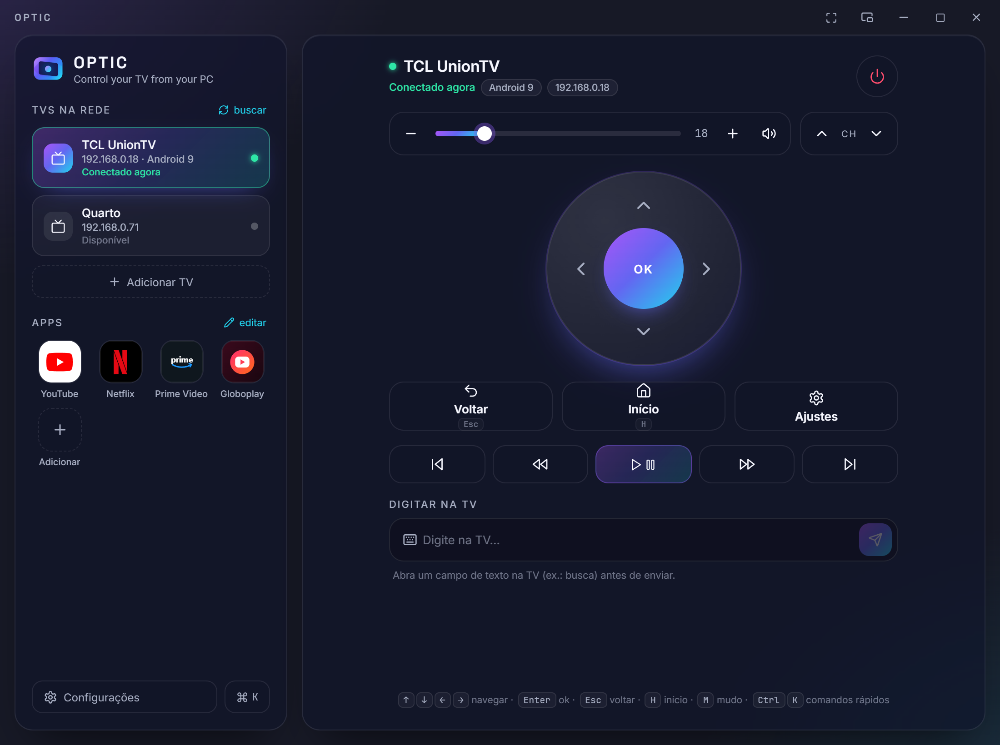
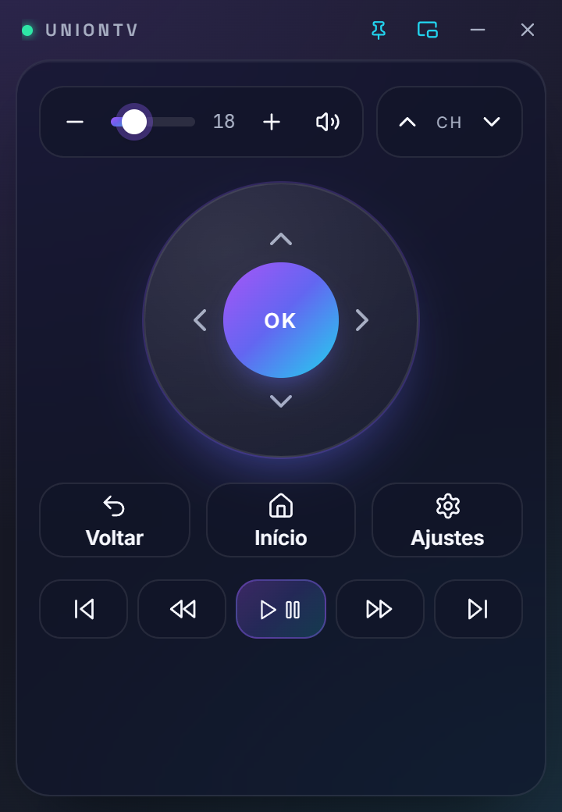
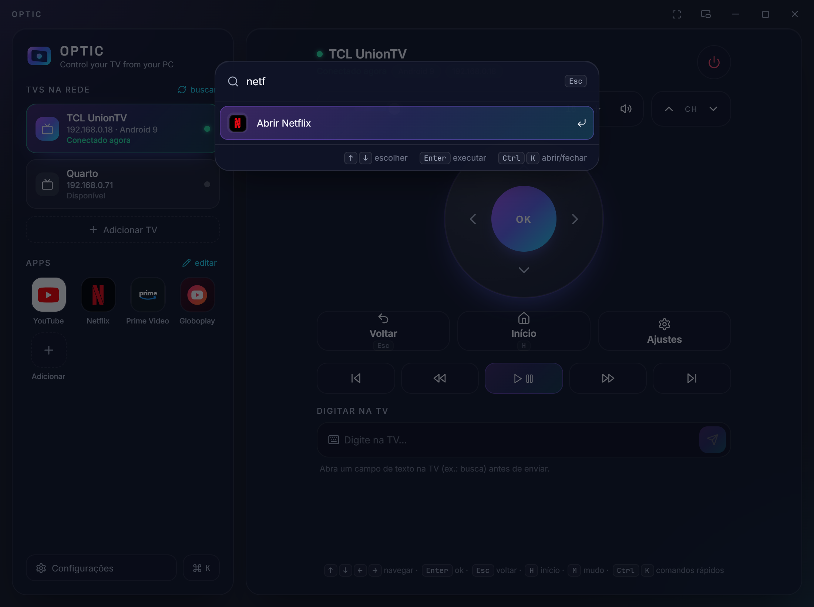
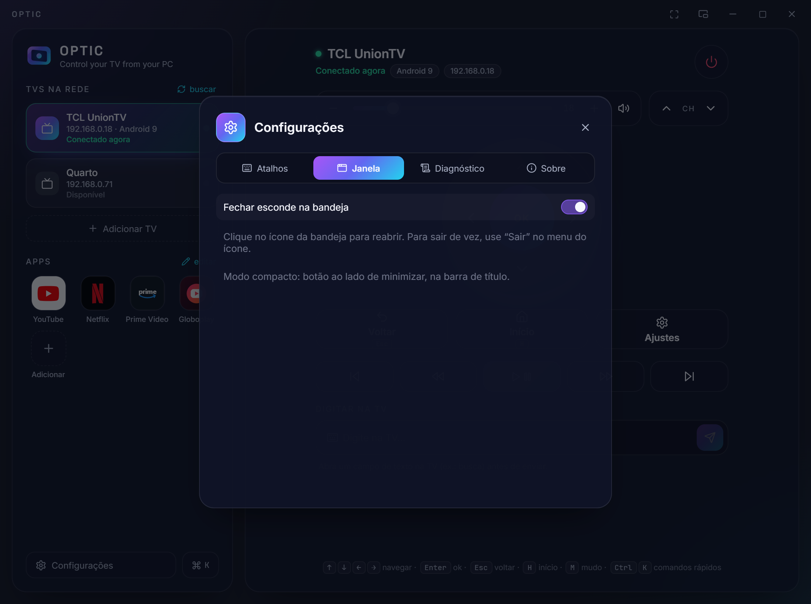

<div align="center">

[Português](README.md) · **English**



# OPTIC

**Control your TV from your computer.** No extra hardware, no cloud, no account.

Open source desktop remote for **Android TV, Google TV, Roku, LG webOS and Samsung Tizen**, talking straight to the TV over your local network: the Android TV Remote protocol v2, implemented from scratch in Go, Roku's official protocol (ECP), LG's (SSAP) and Samsung's network remote.

[**Download**](https://github.com/andredeomondes/optic/releases/latest) ·
[**Install and usage guide**](https://andredeomondes.github.io/optic/en/index.html) ·
[Architecture](docs/ARCHITECTURE.md) ·
[Protocol](docs/PROTOCOL.md)




</div>

## Features

- **Finds your TV by itself** on the network (mDNS and SSDP) and pairs with the 6-character code shown on the screen.
- **Roku TVs** (Philco, AOC, TCL Roku…): no pairing; keys, text, apps, inputs (HDMI) and power on/off.
- **LG TVs (webOS)**: tap **Allow** on the TV once; exact volume, text, apps, inputs and on-screen messages (`Ctrl+K` › "notify tv …").
- **Samsung TVs (Tizen, 2016+)**: tap **Allow** on the TV once; keys, text when the TV keyboard is open, installed apps and power on/off.
- **TV apps** (Roku, LG and Samsung): the real list of installed apps, with search; mark ★ to make a favorite.
- **Input/Source** (Roku TV and LG): switch HDMI with the input button or with `Ctrl+K` › "hdmi 2".
- **Now playing:** the app open on the TV and, on Roku, whether it is playing or paused.
- **Turns the TV on** over the network (Wake-on-LAN), after the first connection with the TV on.
- **Full remote:** D-pad, back, home, volume (with slider), channels, media and power.
- **Opens apps** in one click: YouTube, Netflix, Prime Video, Globoplay and any other by package name (on Roku, LG and Samsung, also the apps installed on the TV).
- **Types on the TV** with the PC keyboard, straight into the search field. `Ctrl+V` pastes the copied text on the TV.
- **Quick commands** (`Ctrl+K`): "netflix", "volume 20", "type …" and more.
- **Keyboard shortcuts:** arrows navigate, `Enter` OK, `Esc` back, `H` home, `M` mute, `+`/`-` volume, space play/pause, `Ctrl+T` type.
- **Global shortcuts** (Windows): `Ctrl+Alt+↑/↓` volume, `Ctrl+Alt+M` mute, `Ctrl+Alt+H` home and `Ctrl+Alt+K` quick commands, even with another window focused. Turn them on and change the keys in Settings › Shortcuts. `Ctrl+Alt` is the same as `AltGr` on some keyboards; if a shortcut stops you from typing a character, change it.
- **Media keys** on the PC keyboard (play/pause, next, previous, stop) controlling the TV, optional.
- **Volume with the mouse wheel** over the remote (with the TV connected) and from the tray menu.
- **Sleep timer** to turn the TV off in 15, 30, 60 or 90 minutes (or "turn off in 45 min" in `Ctrl+K`).
- **New version notice:** the app tells you when a new release is out (you can turn it off in Settings). The check only reads the public releases page on GitHub; no data about you or the TV is sent.
- **Compact mode** 360×520 that can stay always on top, next to whatever you are doing.
- **System tray** (Windows): closing hides the app in the hidden icons area; opening it again brings back the same window.
- **Full screen** with `F11` and a maximizable window.
- **100% local:** the remote does not go through servers. The pairing certificate stays only on your PC.

> To turn the TV on over the network, the **Network standby** option (or equivalent) must be enabled on the TV.

<table>
  <tr>
    <td align="center"><br/><sub>Compact mode</sub></td>
    <td align="center"><br/><sub>Quick commands (Ctrl+K)</sub></td>
  </tr>
  <tr>
    <td colspan="2" align="center"><br/><sub>Settings › Window</sub></td>
  </tr>
</table>

## Install

Download from [**Releases**](https://github.com/andredeomondes/optic/releases/latest):

| System | File | How to install |
|---|---|---|
| Windows 10/11 | `OPTIC-windows-amd64-setup.exe` | Open it and follow the installer. Shortcut in the Start menu and on the desktop. |
| macOS 11+ (Intel and Apple Silicon) | `OPTIC-macos-universal.dmg` | Drag OPTIC to Applications. First time: right-click › **Open**. |
| Linux (x64) | `OPTIC-linux-amd64.tar.gz` | Extract and run `./install.sh` (installs for your user, no root). |

The step by step, including the SmartScreen and Gatekeeper warnings (the binaries are not signed yet), is in the [**guide**](https://andredeomondes.github.io/optic/en/index.html).

## First use

1. PC and TV on the **same network** (Wi-Fi or cable).
2. Open OPTIC: the TV shows up under **TVs on the network** (or use **Add TV** with its IP).
3. Click it. The TV shows a **6-character code**: type it in OPTIC.
4. Done. Next time OPTIC reconnects by itself.

> Roku not responding? On the TV: Settings › System › Advanced system settings › Control by mobile apps › Network access: **Default**.

> LG does not turn on over the network? On the TV, enable *LG Connect Apps* and *Turn on via Wi-Fi* (or *Turn on with Mobile*), depending on the model.
>
> Samsung does not ask for permission? On the TV: General › External Device Manager › Device Connection Manager › Access Notification: **On**. To turn it on over the network, enable *Turn on with mobile device*.
>
> LG and Samsung support was tested with protocol simulators; if something does not work on your TV, open an issue with the diagnostics report.

> Netflix and Prime Video use their own keyboard, which does not receive text through the protocol. Use the arrows and OK, or the TV's global search.

## Development

```bash
git clone https://github.com/andredeomondes/optic && cd optic
wails build -skipbindings                  # app in build/bin/
wails build -skipbindings -nsis            # + Windows installer
cd frontend && npm install && npm run dev  # UI only, with a fake backend
```

Tests: `go test ./...` and, in the frontend, `npx tsc --noEmit && npm test`. Details in [docs/DEVELOPMENT.md](docs/DEVELOPMENT.md).

### Structure

```
main.go · app.go · shell.go   composition + delivery via Wails
internal/domain               types, errors and ports
internal/control              use cases (tested with fakes)
internal/adapter/             atv (protocol) · mdns (discovery) · filestore (config)
internal/platform/tray        system tray
pkg/atvremote                 Android TV Remote v2: pairing (6467) and control (6466)
pkg/discovery                 mDNS
cmd/optic                     diagnostics CLI (discover, pair, key, type, watch)
frontend/src                  lib · hooks · components
site/                         install and usage guide (GitHub Pages)
```

More details in [docs/ARCHITECTURE.md](docs/ARCHITECTURE.md).

### CLI

```bash
go run ./cmd/optic discover -v
go run ./cmd/optic pair 192.168.0.18
go run ./cmd/optic key 192.168.0.18 HOME DPAD_DOWN DPAD_CENTER
go run ./cmd/optic watch 192.168.0.18    # everything the TV sends, decoded
```

## Roadmap

- [ ] TV screen preview via ADB
- [ ] Typing in apps with their own keyboard (ADB `input text`)
- [ ] Signed binaries (Windows and macOS)
- [ ] Tray on macOS and Linux

## License

[MIT](LICENSE)
