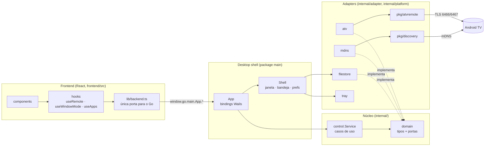
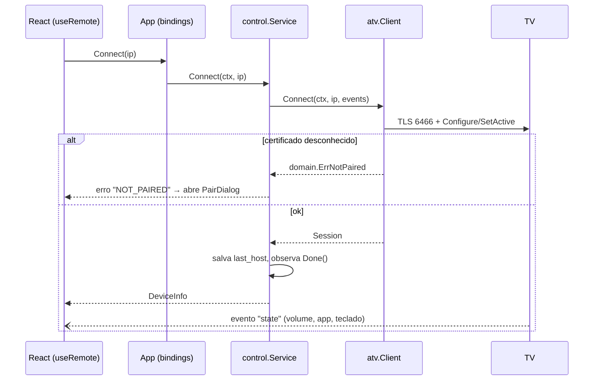

# Arquitetura

OPTIC é um app desktop (Go + [Wails v2](https://wails.io) + React) que controla Android TV / Google TV pela rede local com o **Android TV Remote protocol v2**, implementado do zero em Go.

Este documento explica como o código está organizado, por quê, e onde mexer para cada tipo de mudança.

## Visão geral



### Regra de dependência

As setas de import só apontam **para dentro**:

```
main (composição) ──► adapters ──► domain ◄── control (casos de uso)
                          │
                          └──► pkg/atvremote, pkg/discovery (bibliotecas)
```

- `internal/domain` não importa nada do projeto nem de bibliotecas externas: só tipos (`TV`, `DeviceInfo`, `State`), erros e **portas** (interfaces).
- `internal/control` (casos de uso) depende apenas de `domain`. Não sabe que existe Wails, TLS ou mDNS.
- `internal/adapter/*` implementam as portas usando o mundo real (protocolo, rede, disco).
- `main.go` é o **composition root**: o único lugar que cria adapters e injeta dependências.
- `pkg/atvremote` e `pkg/discovery` são bibliotecas reutilizáveis (usadas também pela CLI em `cmd/optic`), sem conhecer o app.

## Camadas

| Pasta | Papel | Depende de |
|---|---|---|
| `internal/domain` | Entidades, erros de negócio e portas: `Discoverer`, `Connector`, `Session`, `Pairer`, `PairingSession`, `HostStore`, `EventSink` | nada |
| `internal/control` | Casos de uso: descobrir, parear, conectar, enviar tecla/texto/app, ajustar volume | `domain` |
| `internal/adapter/atv` | `Connector`, `Pairer` e `Session` sobre o protocolo Remote v2 | `domain`, `pkg/atvremote` |
| `internal/adapter/webos` | `Connector`, `Pairer` (confirmação na TV) e `Session` sobre o SSAP da LG; chaves em `webos_keys.json` | `domain`, `pkg/webos`, `keystore` |
| `internal/adapter/tizen` | `Connector`, `Pairer` (confirmação na TV) e `Session` da Samsung; tokens em `samsung_tokens.json` | `domain`, `pkg/tizen`, `keystore` |
| `internal/adapter/keystore` | Chaves/tokens por TV num arquivo JSON (gravação atômica, 0600) | stdlib |
| `internal/adapter/roku` | `Connector`, `Session` e ligar pela rede sobre o ECP da Roku (estado por polling) | `domain`, `pkg/roku` |
| `internal/adapter/registry` | Escolhe o adapter pela plataforma de cada TV | `domain` |
| `internal/adapter/mdns` | `Discoverer` via mDNS | `domain`, `pkg/discovery` |
| `internal/adapter/ssdp` | `Discoverer` via SSDP (Roku, LG, Samsung); nomes das Roku pelo device-info | `domain`, `pkg/ssdp`, `pkg/roku` |
| `internal/adapter/filestore` | `HostStore` e preferências em arquivos na pasta de config | `domain` |
| `internal/platform/tray` | Ícone na bandeja (Windows) ou no-op (outros SOs) | `energye/systray` (só Windows) |
| `internal/platform/hotkey` | Atalhos globais e teclas de mídia com `RegisterHotKey` numa thread própria (Windows) ou no-op | stdlib (`user32.dll` no Windows) |
| `main` (`main.go`, `app.go`, `shell.go`) | Composição + entrega via Wails: bindings, janela, eventos | tudo acima |
| `pkg/atvremote` | Protocolo: TLS, pairing Polo, mensagens protobuf codificadas à mão | stdlib, `protowire` |
| `pkg/discovery` | mDNS/zeroconf | `zeroconf` |
| `pkg/roku` | Cliente ECP (HTTP na porta 8060): teclas, texto, apps, device-info | stdlib |
| `pkg/webos` | Cliente SSAP (WebSocket 3001/3000): registro com "Permitir", requisições, assinaturas e socket de ponteiro | stdlib, `gorilla/websocket` |
| `pkg/tizen` | Controle remoto da Samsung (WebSocket 8002/8001 com token) e informações pela REST 8001 | stdlib, `gorilla/websocket` |
| `cmd/optic` | CLI de diagnóstico e engenharia reversa | `pkg/*` |

## SOLID na prática

- **S — responsabilidade única.** `App` só traduz chamadas do JS; `control.Service` só orquestra casos de uso; `Shell` só cuida de janela/bandeja; `filestore` só persiste. No frontend, `lib/backend.ts` é o único arquivo que fala com o Go, `hooks/` guardam estado e `components/` só desenham.
- **O — aberto/fechado.** Suportar outro protocolo (ex.: Samsung, LG) é escrever um novo adapter que implemente `Connector`/`Session`; `control` não muda. Comandos do Quick Command entram por lista (`lib/commands.ts`) sem tocar no parser.
- **L — substituição de Liskov.** Qualquer `Session` (real ou fake) satisfaz o mesmo contrato; os testes de `control` rodam inteiros com fakes.
- **I — segregação de interfaces.** Portas pequenas e específicas: `HostStore` tem 2 métodos, `Discoverer` tem 1. `Connector` e `Pairer` são separados mesmo sendo implementados pelo mesmo `atv.Client`.
- **D — inversão de dependência.** Casos de uso recebem portas por `control.Deps`; o tray recebe callbacks (`tray.Handlers`) em vez de chamar o Wails; a bandeja não conhece a janela, e a janela não conhece o protocolo.

## Fluxos principais

### Conectar



### Fechar a janela

`X` / Alt+F4 → `Shell.beforeClose`: se "Fechar esconde na bandeja" estiver ligado **e** o ícone da bandeja existir, a janela é escondida e o processo continua; senão o app fecha. "Sair" no menu da bandeja marca `quitting` e encerra de verdade. Uma segunda execução do exe aciona `SingleInstanceLock` → `Shell.onSecondInstance` → a janela existente volta.

## Frontend

```
frontend/src
├── lib/         sem React: integração Wails (backend.ts), tipos, catálogo de apps,
│                parser do Quick Command, atalhos, storage seguro
├── hooks/       estado: useRemote (contexto com conexão e ações), useWindowMode
│                (normal/compacto/tela cheia), useApps, useShortcuts, useNow
├── components/  um componente por bloco da UI; RemoteControl aceita `compact`
└── devStub.ts   backend falso para `npm run dev` no navegador
```

Componentes nunca importam `wailsjs/` direto: tudo passa por `lib/backend.ts`, o que permite o `devStub` e facilita trocar a ponte.

## Onde mexer

| Quero… | Arquivo(s) |
|---|---|
| Nova tecla | `pkg/atvremote/keys.go` (`Keys`) e, se tiver botão, `frontend/src/lib/shortcuts.ts` |
| Novo app no launcher | `frontend/src/lib/apps.ts` (catálogo) |
| Novo comando no Ctrl+K | `frontend/src/lib/commands.ts` |
| Novo caso de uso | método em `internal/control/service.go` + teste, binding em `app.go`, `frontend/wailsjs/go/main/App.{js,d.ts}`, `lib/backend.ts` e `devStub.ts` |
| Outro tipo de TV | novo pacote em `internal/adapter/` implementando `domain.Connector`/`Session`, escolhido em `main.go` |
| Comportamento da janela/bandeja | `shell.go`, `internal/platform/tray` |
